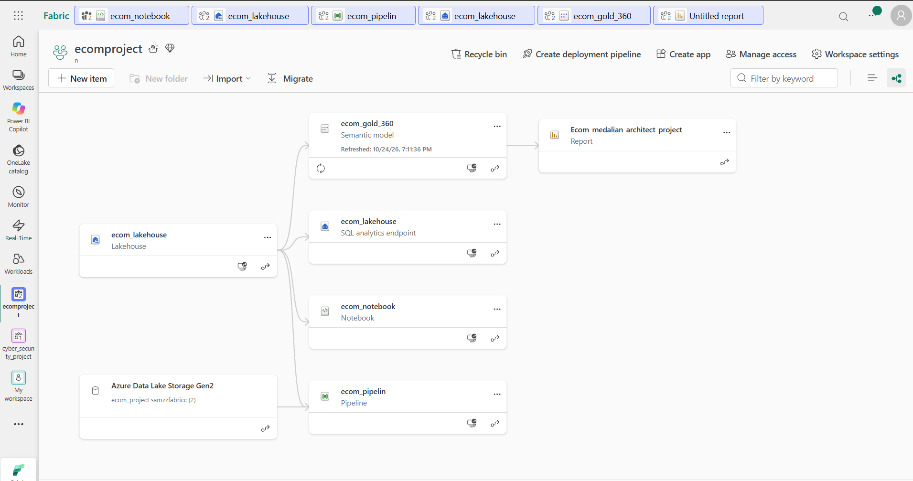
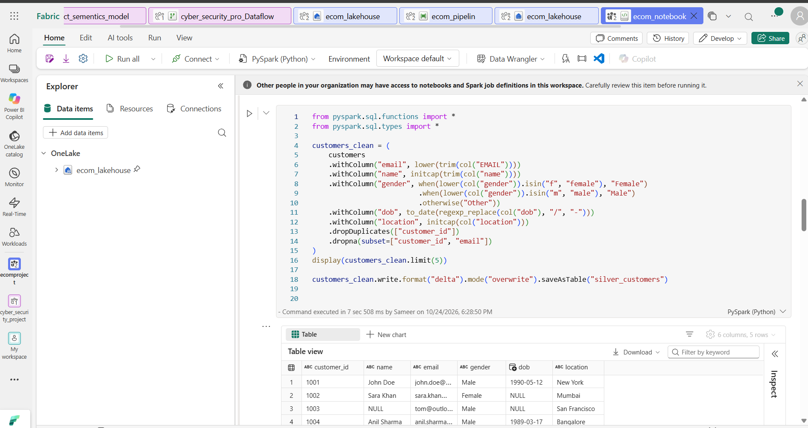
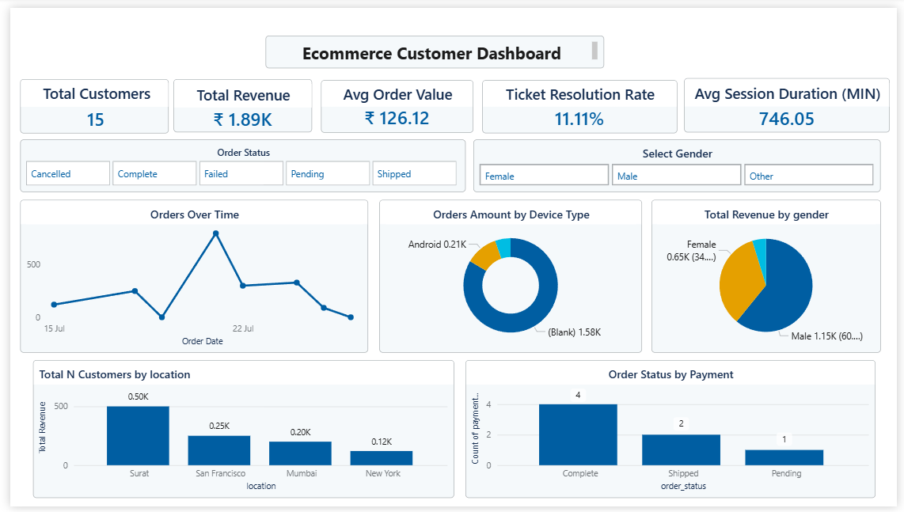

# ecom-fabric-medallion-analytics
# 🛒 E-Commerce Customer 360 | Microsoft Fabric & ADLS Gen2 Medallion Architecture

An end-to-end cloud data engineering and analytics solution ingesting multi-channel e-commerce telemetry from Azure Data Lake Storage Gen2 into Microsoft Fabric Lakehouse, processing data through Bronze, Silver, and Gold layers with PySpark, and visualizing customer health in Power BI.

---

## 🏗️ Architecture & Data Lineage



The project leverages Microsoft Fabric's Lakehouse architecture:
1. **Storage Tier:** Azure Data Lake Storage Gen2 (ADLS Gen2) hosting raw operational and web event files.
2. **Ingestion Tier:** Fabric Data Factory Pipeline using `Get Metadata` and `ForEach` iteration for dynamic file ingestion into Bronze storage.
3. **Processing Tier:** Microsoft Fabric Spark Notebooks (PySpark) performing data cleansing, type enforcement, and dimensional joins.
4. **Storage Format:** Linux Foundation Delta Lake (Parquet-backed ACID storage).
5. **Serving Tier:** Direct Lake Semantic Model (`ecom_gold_360`) connected live to Power BI.

---

## ⚡ PySpark Medallion Transformations



### Key Transformation Logic:
* **Bronze to Silver:**
  * Cleaned email strings, trimmed whitespace, and unified casing using `lower(trim(col("email")))`.
  * Standardized non-uniform date strings using regular expression pattern matching:
    ```python
    orders_clean = (
        orders
        .withColumn("order_date", 
            when(col("order_date").rlike(r"^\d{4}/\d{2}/\d{2}$"), to_date(col("order_date"), "yyyy/MM/dd"))
            .when(col("order_date").rlike(r"^\d{2}-\d{2}-\d{4}$"), to_date(col("order_date"), "dd-MM-yyyy"))
            .when(col("order_date").rlike(r"^\d{8}$"), to_date(col("order_date"), "yyyyMMdd"))
            .otherwise(to_date(col("order_date"), "yyyy-MM-dd"))
        )
    )
    ```
  * Filtered negative financial values and removed duplicates across primary key subsets.

* **Silver to Gold (`gold_customer360`):**
  * Denormalized 5 relational entities (`silver_customers`, `silver_orders`, `silver_payments`, `silver_support`, `silver_web`) into a unified Customer 360 dataset.
  * Resolved ambiguous column references (`o.amount` vs `p.amount`) to ensure optimal Catalyst physical execution plans.

---

## 📊 Executive Customer 360 Dashboard



### Core Business Metrics:
* **Customer Acquisition & Volume:** Total customer base, geographic distribution, and device usage breakdowns.
* **Order Health & Fulfilment:** Revenue tracking over time, Average Order Value (AOV), and order completion statuses.
* **Support & Retention:** Customer support incident volume, resolution ratios, and engagement session durations.

---

## 🛠️ Technology Stack
* **Cloud Platform:** Microsoft Azure, Microsoft Fabric
* **Data Lake:** Azure Data Lake Storage Gen2, OneLake
* **Data Processing:** Apache Spark, PySpark, Python
* **Data Modeling & Visualization:** Power BI, DAX, Direct Lake
